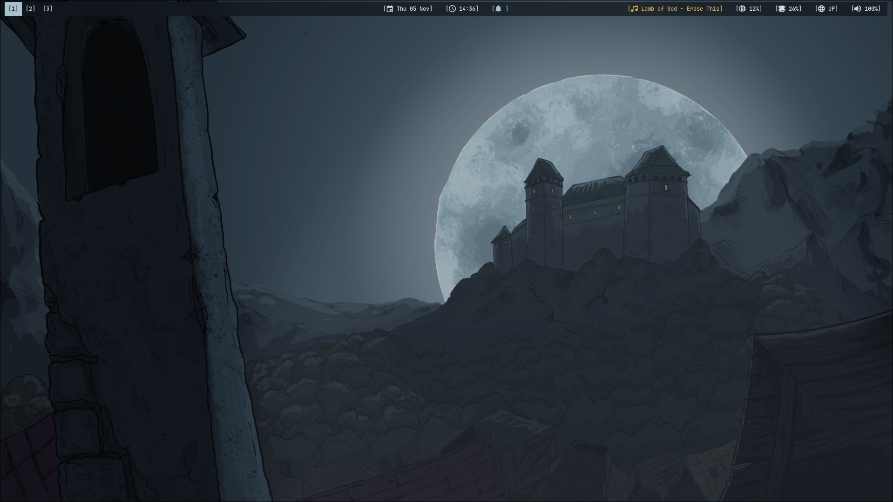
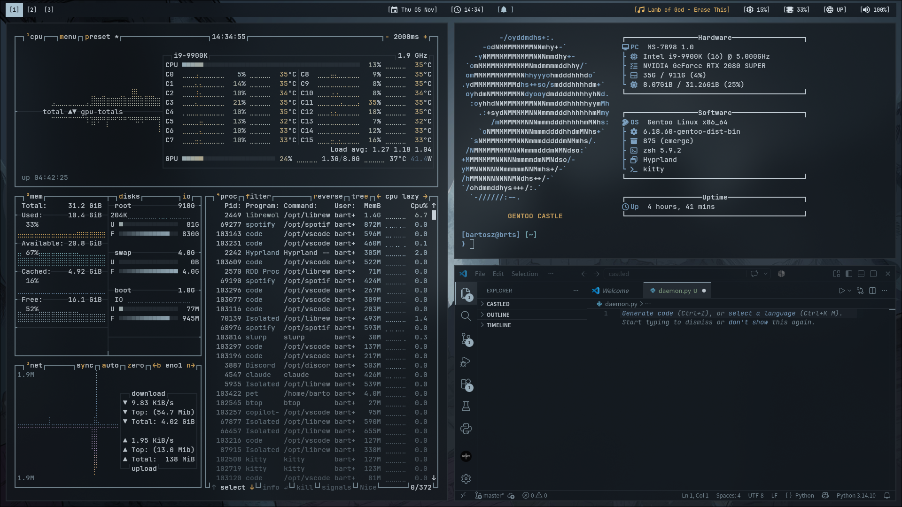
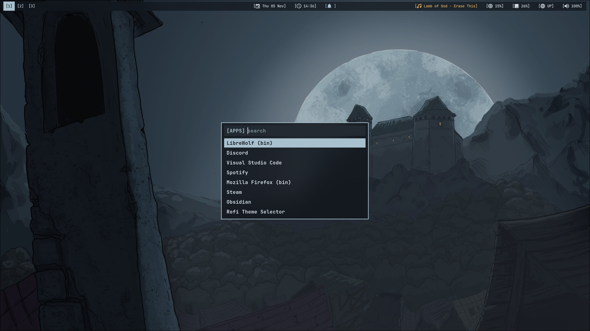
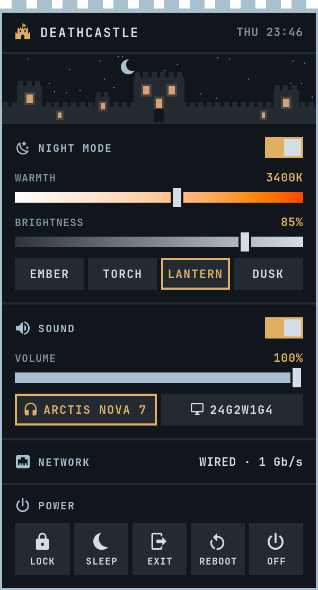

<div align="center">



<br>


**[Features](#features)** &nbsp;/&nbsp; **[Install](#install)** &nbsp;/&nbsp; **[Customize](#customize)** &nbsp;/&nbsp; **[Safety](#built-to-be-safe)** &nbsp;/&nbsp; **[Roadmap](#roadmap)**

</div>



DEATHCASTLE turns a Hyprland desktop into one consistent environment. Every color comes from a single plain-text palette, sampled from a moonlit castle wallpaper. Change a value, run one command, and every app follows.

<div align="center">
  
</div>

## Features

- **One palette, every app.** A single file drives the whole desktop, so nothing drifts out of sync.
- **Hard corners.** Square edges by default, with thin borders and a clean bracket-style bar.
- **Readable by design.** Slate blue base, moonlight text and one main accent. Amber is reserved for things that need your attention.
- **Focus you can see.** The active window stays sharp while the others turn to frosted glass.
- **Safe to try.** Preview every change first, and get an automatic backup of anything replaced.
- **Plain and hackable.** Shell scripts and text files, with nothing hidden and no background services.

## Gallery

<table>
  <tr>
    <td width="50%"></td>
    <td width="50%"></td>
  </tr>
  <tr>
    <td align="center"><b>The chamber</b><br><sub>btop, Neofetch and VS Code</sub></td>
    <td align="center"><b>The launcher</b><br><sub>Rofi over frosted glass</sub></td>
  </tr>
</table>

## The castle menu

<table>
  <tr>
    <td width="300" valign="top"></td>
    <td valign="top">

Click the tower on the bar and the castle opens. One small menu holds the controls you reach for most, so the bar stays quiet.

- **Night mode.** Warm and dim every screen with a Hyprland screen shader, so it works on any GPU and every monitor. Drag the warmth and brightness sliders or pick a preset: Ember, Torch, Lantern, Dusk. Changes show while you drag.
- **A living sky.** The sun crosses the sky by day and the moon by night, and the castle windows glow in your current tint.
- **Sound.** Volume, mute and a one-click switch between outputs, such as headset and monitor speakers.
- **Network.** Wired speed or wifi name at a glance. Never your IP.
- **Power.** Lock, sleep, log out, reboot and shut down. The last three ask for a second click and close your apps cleanly first.
- **Screenshot itself.** Press <kbd>P</kbd> for a crisp 2x PNG with a transparent background, saved and copied to the clipboard.

<sub>Comes with <code>./install --samples</code>. Right-click the tower to toggle night mode, scroll it to change the warmth.</sub>

</td>
  </tr>
</table>

## Palette



## What gets themed

| Area | Apps |
| --- | --- |
| **Desktop** | Hyprland, Waybar, Rofi, Mako, Hyprlock |
| **Terminal** | Kitty, Neofetch, btop |
| **Toolkits** | GTK 3, GTK 4, Qt 6 through qt6ct, KDE color scheme for Dolphin |
| **Apps** | LibreWolf, Obsidian, Visual Studio Code |
| **Details** | Font, mouse pointer and wallpaper |

Apps you don't use are simply skipped or left unused.

## Install

```sh
git clone https://github.com/BRTSDEV/deathcastle.git
cd deathcastle

./install --dry-run    # see exactly what would change
./install              # install the theme
```

To get the full look, add the sample configs:

```sh
./install --samples
```

| Option | What it does |
| --- | --- |
| *(none)* | Installs the palette, the generator and the wallpaper, then themes your apps |
| `--samples` | Also installs the sample Hyprland, Waybar, Kitty, Rofi and Neofetch configs, and the castle menu |
| `--dry-run` | Lists every file it would back up or install, and changes nothing |

<details>
<summary><b>Requirements</b></summary>

<br>

**Core:** Hyprland with Lua config support (developed on 0.57), `waybar`, `kitty`, `rofi`, `mako`, `hyprpaper`, `hyprlock`, `hypridle`

**Fonts and icons:** JetBrains Mono, Symbols Nerd Font Mono, Breeze icons, `phinger-cursors`

**Qt apps:** `qt6ct`

**VS Code and Obsidian theming:** `python3`

**Sample config extras:** `grim`, `slurp`, `wl-clipboard` for screenshots, `playerctl` for media, `wireplumber` for volume

**Castle menu:** `python3` with PyGObject (GTK 4) and pycairo, `wireplumber` and `pactl` for sound, `hyprshutdown` for a clean log out, reboot and shut down (falls back to `loginctl` without it), `iw` to show the wifi name

</details>

<details>
<summary><b>Sample config keybinds</b></summary>

<br>

| Keys | Action |
| --- | --- |
| `Super + Q` or `Super + Return` | Terminal |
| `Super + R` | App launcher |
| `Super + E` | File manager |
| `Super + B` | Browser |
| `Super + C` | Close window |
| `Super + V` | Toggle floating |
| `Super + L` | Lock screen |
| `Super + M` | Exit Hyprland |
| `Super + S` | Scratchpad |
| `Super + 1-0` | Switch workspace |
| `Super + Shift + 1-0` | Move window to workspace |
| `Super + Shift + P` | Screenshot a region |
| Click the tower on the bar | Castle menu (<kbd>Esc</kbd> closes, <kbd>P</kbd> screenshots it) |
| `Super + Alt + P` | Screenshot the full screen |

</details>

## Customize

Edit the palette, then regenerate everything:

```sh
$EDITOR ~/.config/deathcastle/palette
~/.config/deathcastle/apply
```

Kitty, Hyprland, Waybar and Mako reload on their own. Other apps pick up the change the next time they start.

> [!NOTE]
> Obsidian themes live inside each vault, so run `apply` again after creating a new one.

## Built to be safe

- **Backups first.** Files are copied to `~/.local/state/deathcastle/` before being replaced.
- **Your browser privacy stays yours.** LibreWolf's privacy settings aren't lowered unless you opt in through the palette, and an existing `user.js` is never overwritten.
- **Nothing runs as root,** and the scripts download nothing.
- **Your palette stays put.** Reinstalling keeps a palette you've already edited.

To undo an install, copy your backup back:

```sh
cp -a ~/.local/state/deathcastle/backup-<date>/. ~/
```

Files from outside your home folder, such as an Obsidian vault stored elsewhere, are in the backup's `outside-home` folder and need to be moved back by hand.

## Known limitations

- Developed and tested on Gentoo with Hyprland 0.57. Other distros should work, but they're untested so far.
- The sample configs use Hyprland's Lua format and need a version that supports it.
- VS Code keeps small rounded corners on menus and popups, because themes can't change them.
- Dolphin draws its own rounded file selection highlight.

## Roadmap

> [!IMPORTANT]
> **The official DEATHCASTLE daemon is in the making.**

## License

The code and configs are released under the [MIT License](LICENSE). The wallpaper is free to use and isn't covered by that license.


<div align="center">
  <sub>Built for people who want their desktop to feel like a castle at midnight.</sub>
</div>
